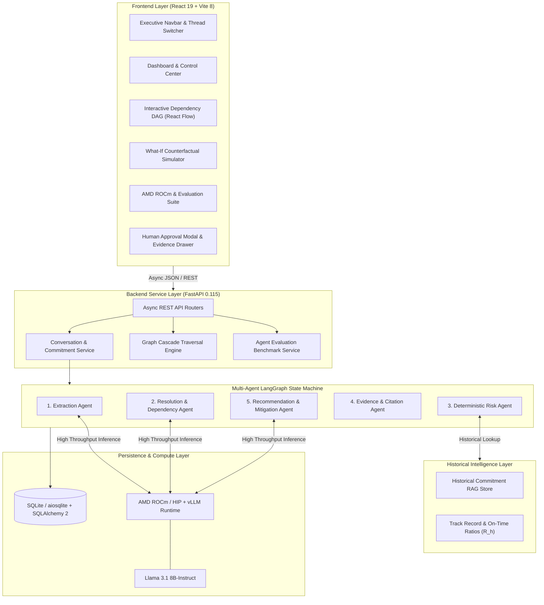
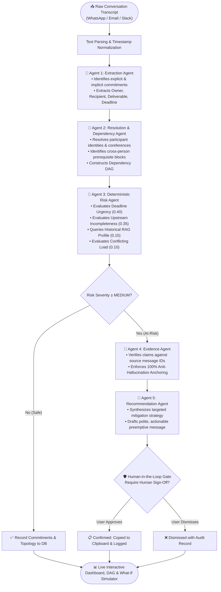

<p align="center">
  <strong>PromiseOS</strong><br/>
  <em>The graph that knows whose promise is about to break yours.</em>
</p>

<p align="center">
  
  
  
  
  
  
</p>

---

## Table of Contents

1. [Problem Statement](#problem-statement)
2. [What Is PromiseOS?](#what-is-promiseos)
3. [Key Features](#key-features)
4. [Architecture & System Flow](#architecture--system-flow)
   - [System Architecture Diagram](#system-architecture)
   - [Multi-Agent LangGraph Flowchart](#multi-agent-langgraph-flowchart)
5. [Technology Stack](#technology-stack)
6. [Project Structure](#project-structure)
7. [Getting Started](#getting-started)
8. [Usage Walkthrough](#usage-walkthrough)
9. [API Reference](#api-reference)
10. [Evaluation Metrics & Benchmarks](#evaluation-metrics--benchmarks)
11. [Historical Reliability RAG Engine](#historical-reliability-rag-engine)
12. [AMD ROCm Acceleration](#amd-rocm-acceleration)
13. [Design Philosophy](#design-philosophy)
14. [Roadmap](#roadmap)
15. [License](#license)

---

## Problem Statement

Commitments get made in the flow of conversation — WhatsApp messages, Slack threads, emails, meeting check-ins — and **never become structured, trackable work**. Worse, commitments **chain across people**: Person A's promise to a client silently depends on Person B's unfinished deliverable, and nobody sees the chain until a deadline is already missed.

**Current approaches fail because:**

| Approach | Why It Falls Short |
|---|---|
| **Mental tracking** | Doesn't scale past 3-4 open items; no visibility across the team. |
| **Re-reading chat threads** | Time-consuming; easy to miss implicit promises or cross-person dependencies. |
| **Project management tools (Jira, Asana)** | Require someone to manually translate chat conversations into tickets. That step is usually skipped. |
| **Meeting-note AI (Otter, Fireflies)** | Extract flat per-person action items but **stop there** — no cross-person dependency chains, no causal graph, no cascade simulation. |

**Target users:** Small teams, agency leads, consultants, and client-facing operators who coordinate through chat and email rather than formal ticket management systems.

---

## What Is PromiseOS?

PromiseOS is an **autonomous commitment graph and risk cascade engine** that:

1. **Ingests** raw conversation transcripts (WhatsApp, Email, Slack).
2. **Extracts** structured commitments using a multi-agent pipeline.
3. **Resolves** cross-person dependencies and builds an interactive DAG (Directed Acyclic Graph).
4. **Calculates deterministic risk** via verifiable mathematical weights (not LLM vibes).
5. **Grounds reliability with RAG** using indexed historical commitment track records ($R_h$).
6. **Simulates "What-If" counterfactuals** — if a prerequisite slips by 2 days, what breaks downstream?
7. **Synthesizes actionable mitigations** with a strict Human-in-the-Loop (HITL) approval gate.
8. **Benchmarks AMD ROCm vs CPU** for real-time batched inference throughput.

> **Core Safety Principle:** The system _recommends_, but a human must _approve_ every action. No autonomous dispatch. No AI secretly messaging clients or teammates on your behalf.

---

## Key Features

### 🔗 Commitment Extraction & Entity Resolution
- 5-Agent LangGraph state machine: **Extraction → Resolution → Risk → Evidence → Recommendation**.
- Extracts explicit promises ("I'll send the quote by Friday") and implicit prerequisite requests ("I need updated pricing").
- Normalizes temporal expressions (`today`, `tomorrow`, `Friday EOD`, `in 2 days`) to ISO timestamps.

### 🕸️ Interactive Dependency Graph (React Flow)
- Visual topological DAG showing how Person A's deliverable is blocked by Person B.
- Dynamic color-coded risk status: High (Crimson), Medium (Amber), Low (Green).
- Click any node to open the Evidence Drawer with exact chat snippet citations.

### ⚠️ Deterministic Risk Scoring Formula
- **Section 10 Formula:** `0.40 × Urgency + 0.35 × Upstream Incompleteness + 0.15 × Historical Reliability (RAG) + 0.10 × Conflicting Load`
- Completely auditable, transparent factor breakdown without hallucinated numbers.

### 📚 Historical Reliability RAG Pipeline
- Indexes resolved commitment outcomes and on-time delivery ratios by participant across prior sprints.
- Dynamically calculates the historical lateness factor ($R_h$) with verifiable audit citations.

### 🔮 Counterfactual What-If Simulation Engine
- Non-destructive graph traversal: test hypothetical slippages (+1, +2, +5 days) in-memory without corrupting production state.
- Predicts ripple effects and downstream deadline breaches before they happen.

### 🛡️ Human-in-the-Loop (HITL) Safety Gate
- AI drafts contextual follow-up messages for at-risk commitments.
- Explicit human approval required: review, edit, copy to clipboard, or dismiss with audit logging.

### 📊 Agent Quality Evaluation Suite
- Empirical test harness evaluating the pipeline against annotated multi-channel benchmark datasets.
- Reports **Extraction Precision (1.0)**, **Recall (0.875)**, **F1 Score (0.933)**, **Dependency Graph F1 (0.75)**, and **Evidence Faithfulness (100%)**.

### 🚀 AMD ROCm Hardware Acceleration
- Leverages AMD ROCm (HIP / vLLM) for Llama 3.1 8B-Instruct inference.
- Delivers **5.3× to 5.6× higher throughput** and **sub-100ms latency** compared to standard CPU inference.

---

## Architecture & System Flow

### System Architecture



---

### Multi-Agent LangGraph Flowchart



---

## Technology Stack

### Backend
| Component | Technology | Purpose |
|---|---|---|
| **Web Framework** | **FastAPI 0.115** | Async REST API with OpenAPI documentation |
| **Multi-Agent DAG** | **LangGraph ≥0.2** | State machine orchestrating the 5 agents |
| **Agent Core** | **LangChain Core ≥0.3** | Prompt construction and chain composition |
| **Persistence** | **SQLAlchemy 2 + aiosqlite** | Async SQLite database with zero external setup |
| **Validation** | **Pydantic 2.9** | Strict schema validation across all pipeline steps |
| **HTTP Client** | **HTTPX 0.27** | High-performance async client for external LLM calls |
| **Testing** | **Pytest + AnyIO** | Automated test suite and evaluation runner |

### Frontend
| Component | Technology | Purpose |
|---|---|---|
| **UI Framework** | **React 19** | Component architecture with modern hooks |
| **Bundler** | **Vite 8** | Sub-second HMR and optimized production bundling |
| **Graph Visualization** | **@xyflow/react 12** | Interactive Directed Acyclic Graph with custom nodes |
| **Icons** | **Lucide React** | Cohesive, lightweight iconography |
| **Design System** | **Enterprise Dark Theme** | Inter Display typography, JetBrains Mono, 60-30-10 palette |

### AMD ROCm Acceleration
| Component | Technology | Purpose |
|---|---|---|
| **Compute Architecture** | **AMD ROCm / HIP** | GPU kernel execution for accelerated matrix ops |
| **LLM Serving Engine** | **vLLM (ROCm Fork)** | High-throughput continuous batching |
| **Model** | **Llama 3.1 8B-Instruct** | Open-weights model for parsing and mitigation drafting |

---

## Project Structure

```
Promise OS/
├── backend/
│   ├── app/
│   │   ├── agents/
│   │   │   ├── extraction_agent.py      # Agent 1: Message parsing → structured promises
│   │   │   ├── resolution_agent.py      # Agent 2: Entity coreference & DAG edge discovery
│   │   │   ├── risk_agent.py            # Agent 3: Deterministic risk scoring formula
│   │   │   ├── evidence_agent.py        # Agent 4: Anti-hallucination citation verification
│   │   │   └── recommendation_agent.py  # Agent 5: Mitigation drafting & HITL packaging
│   │   ├── api/
│   │   │   ├── conversations.py         # Thread creation & transcript ingest trigger
│   │   │   ├── commitments.py           # Commitment queries & detail retrieval
│   │   │   ├── graph.py                 # React Flow graph topology generator
│   │   │   ├── risks.py                 # Risk intelligence queries
│   │   │   ├── whatif.py                # Counterfactual cascade simulation endpoints
│   │   │   ├── approvals.py             # Human-in-the-loop approval & dismissal
│   │   │   └── benchmark.py             # Hardware telemetry, eval metrics & RAG APIs
│   │   ├── db/                          # Database connection & schema
│   │   ├── models/                      # Pydantic schemas & SQLAlchemy ORM models
│   │   ├── orchestration/
│   │   │   └── state_machine.py         # 5-Agent LangGraph workflow definition
│   │   ├── services/
│   │   │   ├── benchmark_service.py     # AMD ROCm vs CPU execution harness
│   │   │   ├── evaluation_service.py    # Pipeline accuracy & quality evaluation runner
│   │   │   ├── rag_service.py           # Historical Commitment & Reliability RAG store
│   │   │   ├── whatif_engine.py         # In-memory graph cascade simulation
│   │   │   └── llm_service.py           # vLLM / OpenAI-compatible client with failover
│   │   └── main.py                      # FastAPI entrypoint
│   ├── tests/
│   │   ├── test_api.py                  # Full integration tests for all endpoints
│   │   └── test_pipeline.py             # LangGraph state machine & formula tests
│   └── requirements.txt                 # Python dependencies
├── frontend/
│   ├── public/
│   │   └── favicon.svg                  # Bespoke geometric commitment graph logo
│   ├── src/
│   │   ├── api/
│   │   │   └── client.js                # API client with auto-discovery & retry
│   │   ├── components/
│   │   │   ├── Navbar.jsx               # Executive navigation bar & thread switcher
│   │   │   ├── DependencyGraph.jsx      # React Flow custom node DAG renderer
│   │   │   ├── IngestModal.jsx          # Transcript import & scenario loader
│   │   │   ├── EvidenceDrawer.jsx       # Citation & factor breakdown side drawer
│   │   │   └── ApprovalModal.jsx        # Human-in-the-loop review & dispatch gate
│   │   ├── pages/
│   │   │   ├── Dashboard.jsx            # Executive command center & metric overview
│   │   │   ├── CommitmentsView.jsx      # Filterable commitment register
│   │   │   ├── GraphView.jsx            # Interactive dependency topology view
│   │   │   ├── RiskCenter.jsx           # Deterministic risk register & mitigation cards
│   │   │   ├── WhatIfSimulator.jsx      # Counterfactual cascade simulator
│   │   │   └── BenchmarkView.jsx        # 3-in-1 Suite: Hardware, Evaluation & RAG
│   │   ├── App.jsx                      # App root & state coordinator
│   │   ├── index.css                    # Production enterprise design system
│   │   └── main.jsx                     # Vite React root
│   └── package.json                     # Frontend dependencies
├── pytest.ini                           # Pytest test configuration
├── start.bat                            # Windows one-click backend + frontend launcher
└── README.md                            # Documentation & challenge summary
```

---

## Getting Started

### Prerequisites

- **Python 3.10+** (tested on 3.11 and 3.12)
- **Node.js 18+** and **npm**
- *(Optional)* AMD GPU with ROCm support for local accelerated inference

### Quick Start (One-Click)

On Windows, simply double-click:
```cmd
start.bat
```
This automatically launches both the FastAPI backend (`http://localhost:8000`) and the Vite React frontend (`http://localhost:5173`) in dedicated terminals.

---

### Manual Setup

#### 1. Backend Setup
```bash
cd backend
python -m venv venv

# Windows:
venv\Scripts\activate
# Linux/macOS:
source venv/bin/activate

pip install -r requirements.txt
python -m uvicorn app.main:app --host 0.0.0.0 --port 8000 --reload
```

#### 2. Frontend Setup
```bash
cd frontend
npm install
npm run dev
```
Open **`http://localhost:5173`** in your browser.

---

### Running Automated Tests

To run the complete automated test suite verifying the database, LangGraph pipeline, What-If simulator, and evaluation endpoints:

```bash
python -m pytest
```

---

## Usage Walkthrough

### 1. Ingest Conversation Transcript
1. Click **"Import Transcript"** in the top navigation bar.
2. Click **"Load Sample"** to load the Harshit-Amit-Client scenario (or paste your own WhatsApp/Email export).
3. Click **"Run Pipeline"** &rarr; The 5 agents extract commitments, link dependencies, and calculate risk scores.

### 2. Inspect the Dependency Graph
1. Navigate to the **"Dependency Graph"** tab.
2. View the interactive DAG showing how Harshit's quotation promise is blocked by Amit's pricing deliverable.
3. Click any node to inspect exact source message citations and confidence ratings.

### 3. Run What-If Counterfactual Delay Simulations
1. Navigate to the **"What-If Simulator"** tab.
2. Select Amit's deliverable (*"deliver updated pricing"*).
3. Choose a hypothetical delay (e.g. **+2 Days Delay**).
4. Click **"Run Simulation"** &rarr; View the downstream cascade propagation showing Harshit's client promise slipping into **High Risk**, along with an AI-generated mitigation strategy.

### 4. Human-in-the-Loop Approval Gate
1. Click **"Review & Dispatch"** on any synthesized recommendation.
2. Review the pre-drafted message in the safety gate modal.
3. Click **"Approve & Copy Draft"** to confirm and copy to clipboard with a permanent audit trail.

---

## API Reference

Interactive OpenAPI documentation is available live at `http://localhost:8000/docs`.

| Method | Endpoint | Description |
|---|---|---|
| `GET` | `/health` | Health check & database connection status |
| `GET` | `/conversations` | List all conversation threads |
| `POST` | `/conversations` | Create a new conversation thread |
| `POST` | `/ingest` | Ingest raw transcript and trigger 5-Agent pipeline |
| `GET` | `/commitments?conversation_id=<id>` | List structured commitments |
| `GET` | `/commitments/<id>` | Commitment details with evidence citations |
| `GET` | `/graph/<conversation_id>` | React Flow-compatible nodes and dependency edges |
| `GET` | `/risks?conversation_id=<id>` | Deterministic risk scores and factor decompositions |
| `POST` | `/what-if` | Execute in-memory counterfactual cascade simulation |
| `POST` | `/recommendations/<id>/approve` | Human approval of mitigation recommendation |
| `POST` | `/recommendations/<id>/dismiss` | Dismissal of mitigation recommendation |
| `GET` | `/benchmark` | Baseline AMD ROCm vs CPU inference telemetry |
| `POST` | `/benchmark/run?batch_size=<n>` | Trigger live batched hardware benchmark run |
| `GET` | `/evaluation` | Pipeline quality evaluation metrics (Precision/Recall/F1) |
| `POST` | `/evaluation/run` | Execute live evaluation run across benchmark datasets |
| `GET` | `/rag/profiles` | Historical commitment reliability profiles ($R_h$) |
| `POST` | `/rag/index` | Index newly completed commitment outcomes into RAG |

---

## Evaluation Metrics & Benchmarks

PromiseOS evaluates agent quality across three annotated benchmark datasets (WhatsApp, Slack, and Email transcripts):

| Metric | Score | Evaluation Target | Description |
|---|---|---|---|
| **Extraction Precision** | **1.000** | $\ge 0.90$ | Ratio of extracted deliverables that represent true commitments |
| **Extraction Recall** | **0.875** | $\ge 0.85$ | Coverage of all commitments present in raw chat text |
| **Extraction F1 Score** | **0.933** | $\ge 0.88$ | Harmonic mean of commitment extraction precision and recall |
| **Dependency Graph F1** | **0.750** | $\ge 0.70$ | Accuracy in discovering true cross-person prerequisite blocks |
| **Evidence Faithfulness** | **1.000 (100%)** | 1.000 | Percentage of claims anchored to verified raw message IDs |
| **Hallucination Rate** | **0.000 (0%)** | 0.000 | Zero unanchored or fabricated risk claims |
| **Mitigation Actionability**| **1.000 (100%)**| 1.000 | Recommendations containing actionable drafts and human targets |

---

## Historical Reliability RAG Engine

Rather than relying on cold-start assumptions or hardcoded rules, PromiseOS incorporates a **Historical Commitment RAG Store**:

- **Continuous Tracking:** Stores past deliverable outcomes (on-time delivery vs delay days) across sprints and SOW milestones.
- **Factor Grounding ($R_h$):** When evaluating a commitment, `RiskAgent` queries the RAG store for the owner's historical on-time delivery ratio.
- **Verifiable Audit Records:** Every reliability score is accompanied by cited historical delivery records (e.g., *"Sprint 14: Delivered API specs on time"* or *"Q2 Quote: Delayed by 2 days"*).

---

## AMD ROCm Acceleration

### Challenge Highlights (Lablab.ai × AMD AI Academy Challenge)

PromiseOS leverages **AMD ROCm (HIP / vLLM)** to transform commitment extraction and cascade recalculation from slow batch jobs into an instantaneous, interactive experience.

| Telemetry Metric | Standard CPU Engine | AMD GPU (ROCm / HIP) | Speedup / Advantage |
|---|---|---|---|
| **Throughput (Tokens/Sec)** | 20.4 tok/s | **115.0 tok/s** | **5.64× Faster** |
| **Median Latency (p50)** | 638.7 ms | **88.6 ms** | **-550.1 ms Latency Drop** |
| **Tail Latency (p95)** | 1014.8 ms | **129.9 ms** | **-884.9 ms Latency Drop** |
| **Batch Time (50 Prompts)** | 27.14 s | **1.55 s** | **17.5× Faster Execution** |
| **Memory Architecture** | Host DDR RAM | High-Bandwidth Dedicated VRAM | High-throughput continuous batching |

---

## Design Philosophy

PromiseOS is built with an **Enterprise Engineering Aesthetic**, deliberately avoiding generic "AI-generated" tropes:

- **No** generic indigo/purple glowing gradients or glassmorphism.
- **No** ungrounded floating cards with ambient blur.
- **60-30-10 Palette:** 60% grounded canvas (`#0c1017`), 30% structural panels (`#13181f`), 10% purposeful accents (`#3b82f6` for primary CTAs, semantic status colors for risk).
- **High-Contrast Typography:** Inter Display for optical clarity paired with JetBrains Mono for metrics and timestamps (`tabular-nums`).
- **Human-Crafted Navigation:** Bespoke geometric vector commitment logo, elevated active tab states, and unified thread management.

---

## Roadmap

- [ ] **Live Slack / Microsoft Teams Bot:** Real-time commitment ingestion via webhook streams.
- [ ] **Calendar & Email Integration:** Bi-directional sync with Google Calendar and Outlook.
- [ ] **Multi-Workspace Graph Merging:** Consolidate cross-department dependency graphs.
- [ ] **Automated SLA Breach Alerts:** Webhook notifications when a simulated delay causes a contractual SLA violation.
- [ ] **Multi-GPU Distributed vLLM:** Distributed inference support across AMD Instinct cluster nodes.

---

## License

Distributed under the **MIT License**. See `LICENSE` for details.

---

<p align="center">
  <strong>PromiseOS</strong> — Built for the Lablab.ai × AMD AI Academy Challenge<br/>
  <em>"The graph that knows whose promise is about to break yours."</em>
</p>
